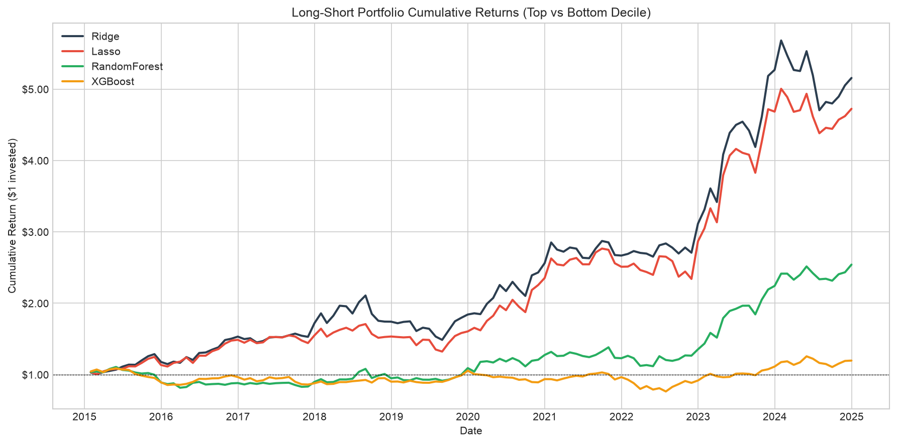
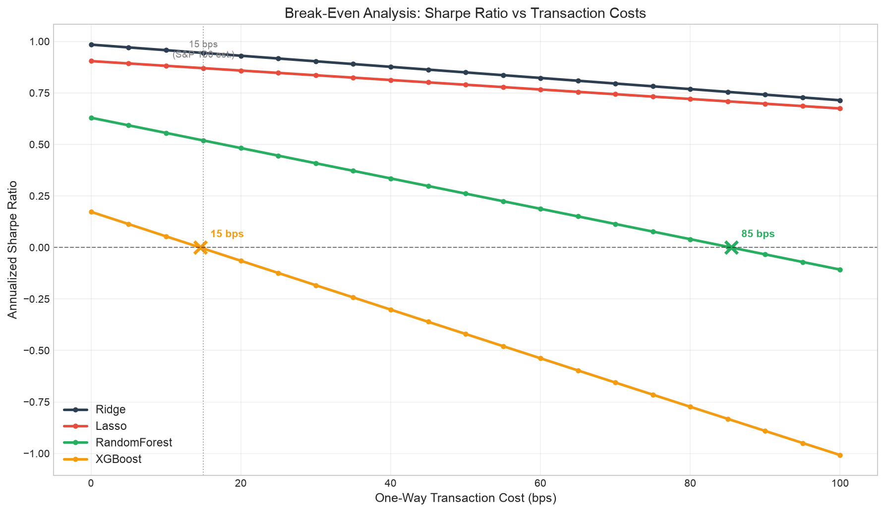
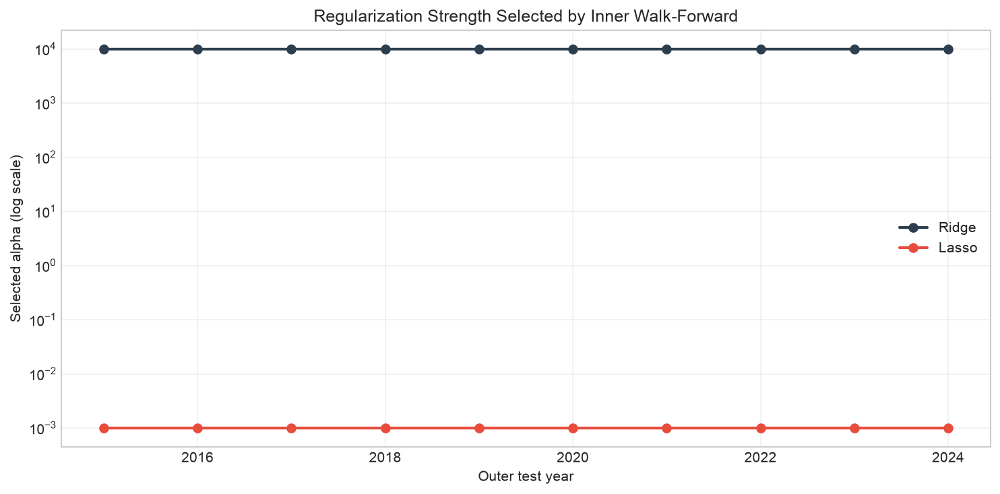
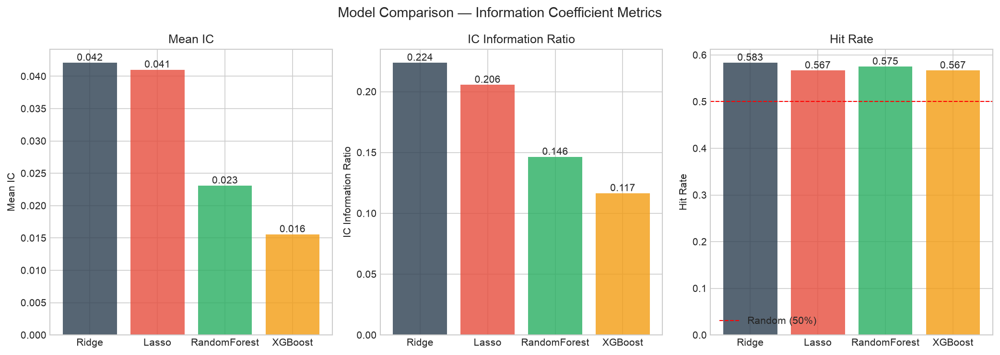
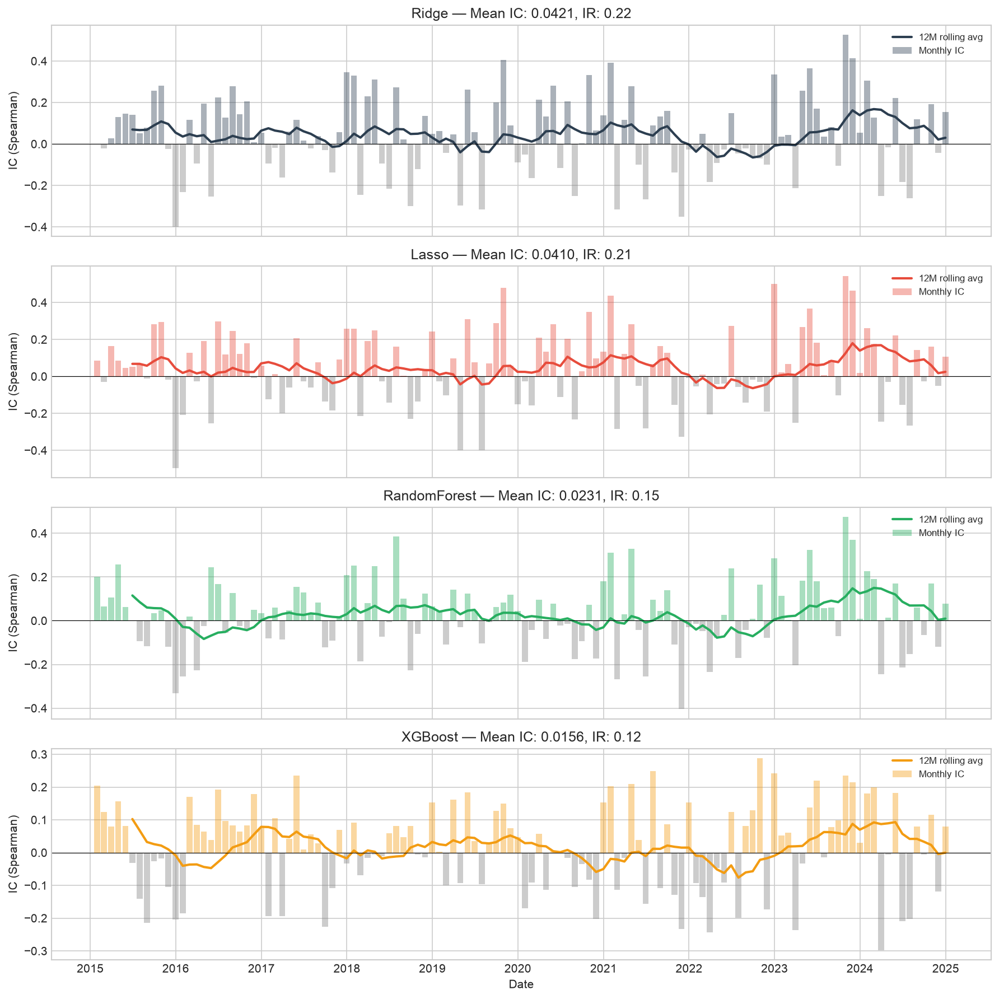
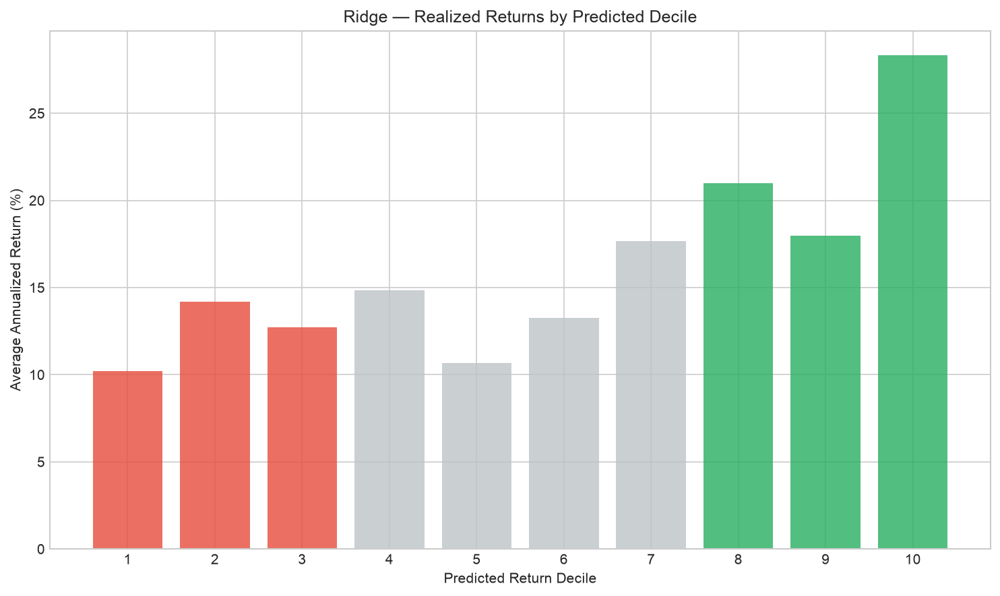
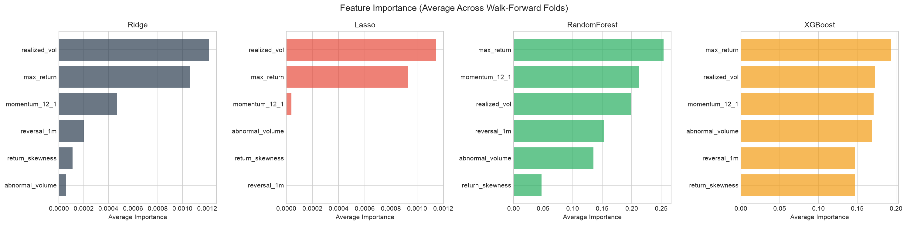
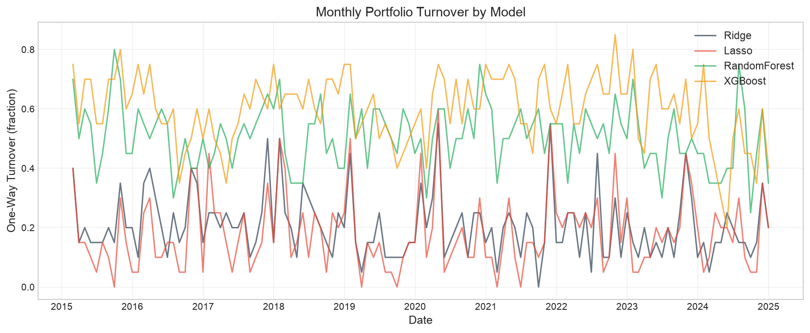

# Cross-Sectional ML Return Prediction

**Can machine learning models capture nonlinear relationships between stock characteristics and future returns, beyond what linear models achieve?**

Monthly cross-sectional US equity return prediction with Ridge, Lasso, Random Forest, and XGBoost. Every result below comes from a fully nested pipeline: hyperparameters are selected by an inner walk-forward on training data only, evaluation uses an outer expanding walk-forward, alphas are benchmarked against the Carhart 4-factor model with Newey-West standard errors, and transaction costs use realized turnover. The project also documents two self-audits (a look-ahead bias and a degenerate-selection bug) whose lessons matter as much as the numbers.

## Headline Results (out-of-sample 2015–2024, 120 months)

| Model | Mean IC (t) | Sharpe gross | Sharpe net 15bps | Turnover | Carhart alpha (t, HAC) | Break-even |
|-------|------------|--------------|------------------|----------|------------------------|------------|
| **Ridge** | **0.042 (2.45)** | **1.00** | **0.94** | 20.6% | **17.9% (2.86)** | >100 bps |
| Lasso | 0.041 (2.25) | 0.92 | 0.87 | 18.2% | 17.8% (2.77) | >100 bps |
| Random Forest | 0.023 (1.60) | 0.65 | 0.52 | 50.8% | 11.6% (1.84) | 85 bps |
| XGBoost | 0.016 (1.28) | 0.21 | -0.01 | 60.0% | 2.8% (0.62) | 15 bps |

### Key Findings

1. **The alpha survives the momentum control.** The feature set includes momentum 12-1 and short-term reversal, so the natural objection is that the "alpha" is just UMD exposure. It is not: Ridge's UMD beta is 0.16 with t = 1.43 (insignificant), and moving from FF3 to Carhart costs only 0.8 points of alpha (18.7% to 17.9%, t_HAC = 2.86). The model's ranking power comes primarily from the low-volatility and lottery (MAX) anomalies, visible in the feature importances, not from momentum.
2. **Both linear models beat both tree models; the two linear models are indistinguishable from each other.** Ridge (1.00) vs Lasso (0.92) is well inside sampling error (Lo-2002 SE ≈ 0.32 each; 95% CIs [0.36, 1.63] and [0.29, 1.55] overlap almost entirely). The linear-vs-tree gap is the robust statement.
3. **XGBoost has no deployable edge**: net of 15 bps its Sharpe is -0.01 and its break-even is exactly the cost assumption (15 bps). Random Forest's Carhart alpha is not significant at 5% (t = 1.84) and its Sharpe is entirely concentrated post-2020 (0.19 pre / 1.01 post), a regime dependence the linear models do not share (Ridge: 0.83 / 1.14).
4. **Symmetric nested tuning did not rescue the trees.** All four models were tuned by the same inner walk-forward on the same folds. The inner CV drives every model toward maximal regularization (Ridge to the heavy-shrinkage plateau, RF to its most-regularized corner in 9/10 folds), which is itself evidence about the signal-to-noise ratio.
5. **Out-of-sample R-squared is ~0.1% for the linear models and negative for the trees** — the textbook shape of monthly equity prediction: negligible level predictability, monetizable ranking ability (positive IC).

## Two Self-Audits

### Audit 1 — Look-ahead via a time-constant feature
An early version included a static log-market-cap feature (today's cap applied to all historical dates). A feature constant in time per ticker is a **ticker identifier**: trees can split on it and memorize which stocks turned out to be the 2015–2024 winners, since today's megacap status embeds exactly that rally. Removing it halved Random Forest's IC (0.054 to 0.027) and erased XGBoost's alpha, while linear models barely moved — they could only extract a bounded "long megacaps" tilt, not per-stock memorization. Walk-forward validation cannot catch this class of leak: the split was correct, the feature construction was contaminated. Note that split-based feature importance also failed to flag it (the feature ranked last in RF's Gini importance): ablation, not importance, is the leak detector.

### Audit 2 — Degenerate selection in nested CV
The first nested-CV run let Lasso select alpha = 0.01 on early folds — a penalty that zeroes every coefficient. Constant predictions cannot rank a cross-section: decile assignment degenerated to row order (an accidental alphabetical portfolio, visible as a two-year stretch of zero turnover followed by a 100% turnover spike). Fix: a **feasibility rule** — any configuration producing (near-)constant predictions on any inner validation year is disqualified (scored -inf), not treated as a "zero-signal" candidate. A strategy that cannot form deciles is outside the feasible set.

## Methodology

### Universe & Data
- **Universe:** S&P 100 constituents (101 tickers after dropping the GOOG duplicate share class). Survivorship bias acknowledged: current list, not point-in-time constituents.
- **Data snapshot:** yfinance, downloaded June 2026; historical adjustments are retroactive, so reruns may differ slightly. Kenneth French Data Library for Mkt-RF, SMB, HML, RF, and UMD.
- **Period:** 2005–2025 monthly; out-of-sample 2015–2024. Panel: 23,232 stock-month observations, 12,084 OOS predictions.
- **Cleaning:** extreme returns (|r| > 200%) flagged; cross-sectional winsorization at 1%/99% per month.

### Features (cross-sectionally standardized each month)
| Feature | Definition | Reference |
|---------|-----------|-----------|
| Momentum 12-1 | Cumulative return t-12 to t-1, skipping last month | Jegadeesh & Titman (1993) |
| Short-term reversal | 1-month lagged return | Jegadeesh (1990) |
| Realized volatility | Rolling 12-month return std | Ang, Hodrick, Xing, Zhang (2006) |
| Maximum return | Max monthly return, past 12 months | Bali, Cakici, Whitelaw (2011) |
| Return skewness | Rolling 12-month skewness | — |
| Abnormal volume | 3-month / 12-month avg volume | Campbell, Grossman, Wang (1993) |

*A static log-market-cap feature was tested and removed — see Audit 1.*

### Nested Walk-Forward Cross-Validation
- **Outer loop (evaluation):** expanding window, train [2006, Y-1], predict year Y, for Y in 2015–2024.
- **Inner loop (selection):** the same annual expanding walk-forward, restricted to the outer training block, scores each hyperparameter configuration by mean validation IC (Spearman) — the quantity the strategy monetizes, not MSE. The outer test year never influences the selection. All four models are tuned symmetrically.
- **Feasibility rule:** configurations producing degenerate (near-constant) predictions on any inner validation year are disqualified.
- **Selected values:** Ridge pins to the heavy-shrinkage plateau (as alpha grows, the Ridge ranking converges to the covariance-weighted score X'y, and IC is scale-invariant — the inner CV is saying "use maximal shrinkage"); Lasso is stable at 0.001 on all 10 folds; RF selects its most-regularized corner (depth 3, min leaf 50) in 9/10 folds. The trajectory is in `figures/alpha_trajectory.png` and `results/selected_hyperparams.csv`.

### Evaluation
- **IC:** monthly Spearman rank correlation, predicted vs realized.
- **Portfolios:** long top decile, short bottom decile, equal-weight, monthly rebalance.
- **Factor models:** FF3 and Carhart 4-factor, Newey-West (HAC, 6 lags) standard errors, OLS t-stats reported alongside for transparency.
- **Costs:** realized turnover from position diffs; 15 bps one-way charged round-trip on traded fraction; break-even swept 0–100 bps.
- **Robustness:** OOS R-squared, Lo (2002) Sharpe confidence intervals, sub-period split (2015–2019 vs 2020–2024), worst months with leg attribution, long/short leg-split alphas.

## Risk Profile (Ridge, headline model)

- **Worst months:** Sep 2018 (-12.2%, long leg -14.3% in the Q4-2018 selloff onset), Jul 2024 (-9.4%, the bottom decile rallied +7.5% in the July-2024 rotation — the short leg bleeding in a violent style rotation, not the long failing), Dec 2015 (-8.5%).
- **Max drawdown:** -29.5%, troughing Aug 2019 — the 2018–2019 factor chop, not the COVID crash. A beta-neutral cross-sectional book is hurt by rotations, not by the crash itself.
- **Leg split (Carhart, HAC):** long leg +29.9%/yr alpha (t = 5.34); the short leg's names themselves earn +12.0%/yr alpha (t = 2.89), i.e. shorting them costs alpha. The edge is long-side dominant — the favorable case for borrow economics, and an argument that a long-only or 130/30 implementation would likely improve net-of-cost Sharpe.

## Figures










## Project Structure

```
cross-sectional-ml-returns/
├── config.py                  # All parameters, documented
├── main.py                    # Full pipeline (7 steps)
├── src/
│   ├── data_loader.py         # Tickers, yfinance, French factors incl. UMD
│   ├── features.py            # 6 features + cross-sectional standardization
│   ├── models.py              # Model definitions
│   ├── nested_cv.py           # Inner walk-forward selection + feasibility rule
│   ├── walk_forward.py        # Outer expanding walk-forward
│   ├── evaluation.py          # IC, portfolios, FF3/Carhart with HAC errors
│   ├── transaction_costs.py   # Realized turnover, net Sharpe, break-even
│   ├── risk_analysis.py       # OOS R2, Sharpe CIs, sub-periods, legs
│   └── utils.py               # Plots
├── data/ · results/ · figures/
└── requirements.txt
```

## Quick Start

```bash
pip install -r requirements.txt
python main.py            # ~10 min (nested CV); --skip-data to reuse parquet
```

## Known Limitations

| Limitation | How to address |
|-----------|----------------|
| Survivorship bias (current S&P 100) | CRSP/Compustat point-in-time constituents |
| No size/value features (dropped for leakage) | Point-in-time fundamentals |
| Flat 15 bps cost | Per-stock impact model (Almgren-Chriss) |
| ~10 names per decile | Larger universe; quintile robustness check |
| Equal-weight, no sector neutrality | Constrained optimizer |

## References

Gu, Kelly & Xiu (2020, RFS) · Jegadeesh & Titman (1993) · Jegadeesh (1990) · Ang, Hodrick, Xing & Zhang (2006) · Bali, Cakici & Whitelaw (2011) · Campbell, Grossman & Wang (1993) · Carhart (1997) · Newey & West (1987) · Lo (2002) · Varma & Simon (2006)
